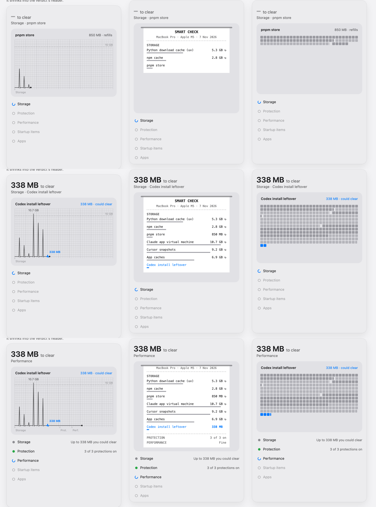
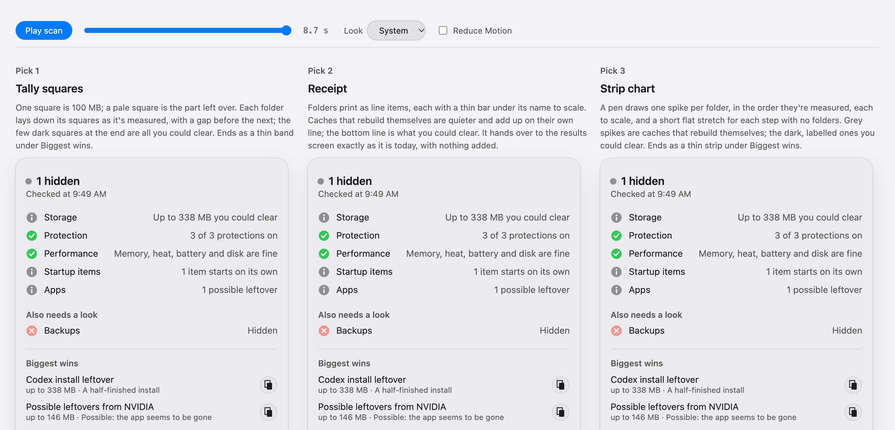

# Audit: the three proposed Smart Check scan graphics

7 Nov 2026. This audit checks the strip chart, receipt and tally squares in [vitals-scan-graphics/sketches.html](vitals-scan-graphics/sketches.html) against three things: Vitals' `CONTRACT.md`, `ETHOS.md` ("true before pretty"), and the real finished screen (`audits/2026-11-vitals/2026-11-07/no-globe/check-light.png`). Frames were checked at 0.5, 1.2, 2.2, 2.6, 5.0, 7.3 and 8.7 s, in light and dark. Contrast figures are WCAG ratios worked out from the sketch colours.

## Overall impression

All three sketches do what the brief asked: sizes are to scale, the wins look small, and the numbers are Evan's real ones. But all three break one contract rule. One of them, the top pick, also has truth problems that the research doc scored as perfect. And the hand-off frame doesn't match the screen the app really shows. After fixes, **tally squares** comes out strongest. The strip chart is still the most delightful, but only if three things are fixed.

## Problems found in all three

| Finding | Severity | Fix |
|---|---|---|
| **Blue used as a category.** Wins are drawn in the accent colour. The contract says "colour only means a status… everything else uses the hierarchical foreground styles". Being clearable isn't a status, and the real verdict screen draws wins in plain text. | 🔴 Critical (contract) | Draw wins in `.primary` (solid, bold) and caches in a quieter style (tertiary trace, quaternary squares, secondary text). The difference between the two kinds survives without colour, which also helps colour-blind readers. |
| **The hand-off doesn't match the real verdict.** The sketch says "● Good" with "Up to 484 MB you could clear". The real screen says "● 1 hidden" with "Checked at 9:49 AM". The sketch has no "Also needs a look: Backups · Hidden", uses dots where the real screen uses status icons, has no Copy for Claude buttons or notes on the wins, centres "Rebuilds itself" instead of right-aligning it, and puts the buttons on the wrong side. The doc's claim that "the end state equals the finished result" is untrue for this frame. | 🔴 Critical (truth) | Redraw the hand-off from the real `SmartCheckCard` verdict, with only the graphic added. The header word must come from `VitalsModel.overall`, never from the scan JSON's `verdict`, which said "good" while the app said "1 hidden". |
| **The label above the graphic goes stale.** During Protection and Performance (3.4 to 6 s), the readout still says "Codex install leftover · 338 MB" while the header says "Performance". Two lines disagree about what is happening now. | 🟡 Moderate | Clear the readout when a stage ends, or show the stage's own result there ("3 of 3 protections on"). |
| **Two words for one thing.** The header says "to clear", the graphic says "could clear", the receipt says "YOU COULD CLEAR", and the verdict says "you could clear". | 🟢 Minor | Pick one. "to clear" matches the app today. |
| **The total is said twice at the end.** "484 MB to clear" in the header and "Could clear 484 MB" in the key say the same thing, which goes against the ethos' "cut secondary labels". | 🟢 Minor | Drop the total from the key; keep only the "Refills on its own 35.7 GB" side, or the swatches alone. |
| **Text too faint to read.** The "10 GB" mark, the stage labels under the strip and similar small text are at about 38% opacity: 2.3:1 contrast in light and 3.1:1 in dark. The contract says "anything Evan needs to read uses at least `.secondary`". | 🟡 Moderate | Use `.secondary` (72%) or remove the text. |
| **Blue text fails contrast anyway.** Small blue labels are 3.1:1 on the module fill in light, 4.0:1 on receipt paper and 3.5:1 in dark. All fail 4.5:1. | 🟡 Moderate | Fixed by the first finding (primary text). |
| **VoiceOver gets nothing.** A `Canvas` is a single image to VoiceOver. | 🟡 Moderate | Add `.accessibilityLabel` with the running state ("Storage, 6 folders measured, 338 MB to clear"), updated per stage, not per frame. |

## 1. Strip chart (the research doc's top pick)

**First impression.** It reads as a heart monitor straight away, which is the point and also the risk. The eye goes to the 10.7 GB spike, a cache that refills, not to the answer. On a bedside monitor, tall spikes mean something is wrong.

| Finding | Severity | Fix |
|---|---|---|
| **The x-axis plots fake time.** x is elapsed time, and the elapsed time is the deliberate pacing (`Pacing.show`), not the scan. So 60% of the strip is a flat line for the Protection, Performance and Startup stages, while every folder is squeezed into the first third, 17 pt apart. The widest part of the graphic shows nothing real. | 🔴 Critical (truth and space) | Use one slot per folder at an even width (about 40 pt), and give stages without folders a short gap with their name. Or drop the idea that x means anything and say so. |
| **Each beat has an invented dip and overshoot.** The beat drops 1.5 pt below zero before the spike and 3 pt after it, copying an ECG wave. That ink stands for no data and suggests negative sizes. | 🟡 Moderate (truth) | Draw a straight up-and-down tick from the baseline: a spike, not a heartbeat. It still reads as a trace. |
| **The dashed "10 GB" line looks like a limit.** On a monitor, a dashed line is an alarm threshold, and the biggest beat crosses it. | 🟡 Moderate | Use a plain small tick on the left edge, with no line across the trace. |
| **The graph paper is decoration.** Two grid weights fill the module and compete with the trace. | 🟢 Minor | Use one faint 40 pt grid, or none. |
| **"Prot." and "Perf." are abbreviations.** Evan is non-technical, and the rows below already name the stages in full. | 🟢 Minor | Remove the labels under the strip; the stage rows already show this. |
| **The bottom of the panel is empty during the scan.** There are about 90 pt of blank space under the rows until the verdict appears. | 🟢 Minor | Fine, if the verdict really grows into that space (see the hand-off finding). |
| **What works.** The live readout, the size label on each win, linear heights with no minimum, and shrinking the strip into a band are all good ideas. The hand-off spring is the best motion moment of the three. | ✅ | |

Revised scores: sense 3, true 3, native 3, delight 5, total **28** (was 33). With the fixes: about **32**.

## 2. Receipt

**First impression.** Instantly understood, and the total at the bottom is the payoff. It's the most "app-like" of the three in a bad way: a white paper card inside a grey module inside a glass panel.

| Finding | Severity | Fix |
|---|---|---|
| **The first folders scroll away.** At the end, uv, npm and pnpm (8.9 GB) have scrolled off the top. The finished picture no longer shows everything it found. | 🟡 Moderate (truth) | Make the receipt the height of the panel at the end (it replaces the stage rows), or shrink the type in the last frame. |
| **Uppercase monospace labels** ("PROTECTION", "YOU COULD CLEAR"). The unslop guide counts tracked uppercase labels as an AI tell, and the app uses sentence-case system styles everywhere else. | 🟡 Moderate | Use sentence case, SF Mono only for the figures, and SF Pro for names. |
| **It repeats the panel.** The receipt reprints "SMART CHECK · MacBook Pro · Apple M5", which the panel header already shows. The stage lines repeat the stage rows underneath. | 🟡 Moderate | Remove the receipt's own header and stage lines; it lists folders only. |
| **↻ is too small to read.** At 11 px the glyph is a smudge, and "STARTUP ITEMS 1" doesn't say one *what*. | 🟢 Minor | Use the SF Symbol `arrow.clockwise` at caption size; say "1 item". |
| **The torn edge is skeuomorphic.** It's charming once, and odd in a Liquid Glass panel. | 🟢 Minor | Keep it only if Evan likes it. |
| **What works.** A small bar under each line shows size at a glance, the two totals are clearly kept apart, and it's the easiest to read. | ✅ | |

Revised scores: true 4, native 2, total **30** (was 32).

## 3. Tally squares

**First impression.** "That's a lot of grey and a little bit of blue", which is exactly the true story. It's calm, and it doesn't feel very new.

| Finding | Severity | Fix |
|---|---|---|
| **Partial squares look like glitches.** The leftover of each folder (0.6 of a square, and so on) draws as a thin sliver mid-row; see the third row at 2.6 s. It reads as a rendering bug, not a fraction. | 🟡 Moderate | Round each folder to whole squares and print the exact size in the readout. Or fill the partial square at lower opacity at full size. |
| **You can't tell folders apart.** The two alternating greys are 1.4:1 apart in light and 1.5:1 in dark, too close to see the boundaries, so it reads as one grey mass. | 🟡 Moderate | Leave a 1-square gap between folders, or briefly highlight the folder being laid down (primary for 0.35 s, then settle). |
| **There's no sense of the whole.** 360 squares with no outline give no clue how big the grid will get. That's correct, because inventing a total would be a lie, but the first second looks like a loading bar. | 🟢 Minor | Fine as it is; the readout carries the meaning early on. |
| **What works.** The fixed unit means it never rescales. It's the only design whose truth doesn't depend on knowing the biggest folder first. It also works in plain monochrome, it's the most native, and the cheapest to draw. | ✅ | |

Revised scores: sense 4, true 5, native 5, delight 3, total **32** (unchanged).

## Visual hierarchy

- **What draws the eye first:** the big header figure ("338 MB") in all three. That's correct, and it matches the app.
- **Second:** the strip chart's tallest grey spike is wrong, because it's a cache that refills. The receipt's bottom total and the tally's grey mass are right.
- **Reading order:** header, then graphic, then stage rows works. During the scan the readout and the header line compete; merge them into one line.

## Accessibility

- **Contrast:** blue labels 3.1 to 4.0:1 ❌; faint text 2.3 to 3.1:1 ❌; primary and secondary text ✅.
- **Click targets:** there are none in the graphic. That's fine, because the verdict's buttons are separate.
- **Reduce Motion:** handled (no sweep, no tween, a fixed stage ring) ✅.
- **VoiceOver:** missing ❌ (see above).

## Priority fixes

1. **Remove the blue**, for all three. Wins in primary text, caches quieter. This is required by the contract and also fixes the contrast failures.
2. **Redraw the hand-off from the real verdict screen**, with "1 hidden", "Also needs a look" and the Copy for Claude buttons. Until then, no sketch can claim the end equals the result.
3. **If the strip chart stays the pick:** one even slot per folder instead of fake time, straight ticks instead of ECG dips, and no dashed threshold line. Otherwise, **make tally squares the lead**: it is the only one that is true without depending on the reveal order.

The research doc's ranking should be read with these revised scores: tally 32, strip 28 (32 once fixed), receipt 30.

## Fixed the same day

All three sketches were redrawn to fix the problems above, and [sketches.html](vitals-scan-graphics/sketches.html) was republished at the same link. The first version is kept in the stills [three-sketches-end.png](vitals-scan-graphics/three-sketches-end.png) and [mid-scan-frames.png](vitals-scan-graphics/mid-scan-frames.png). The fixed renders are [fixed-three-results.png](vitals-scan-graphics/fixed-three-results.png), [fixed-frames-light.png](vitals-scan-graphics/fixed-frames-light.png) and [fixed-frames-dark.png](vitals-scan-graphics/fixed-frames-dark.png).

| Finding | What changed |
|---|---|
| Blue used as a category | Gone everywhere. Wins are drawn solid in primary (black in light, white in dark) and bold. Caches are drawn in a quieter grey with secondary text. The only colours left are the status icons: green ticks, grey info marks and the red Backups mark. |
| Hand-off doesn't match the real verdict | The last frame is now drawn from `check-light.png`, point for point. It has "● 1 hidden", "Checked at 9:49 AM", the app's own status icons, "Also needs a look: Backups · Hidden", the divider, Biggest wins with their notes and Copy for Claude buttons, a right-aligned "Rebuilds itself 35.7 GB", and right-aligned Check again / Done. The step rows slide up into place. The only addition is a 40 pt copy of the graphic under "Rebuilds itself". The receipt adds nothing: it turns into the Biggest wins list. |
| Readout goes stale | During steps with no folders, the readout says "7 folders measured · No folders in this step". The header says "Checking… / Step 3 of 5 · Performance", in the same place as the verdict's "1 hidden / Checked at…". |
| Two words for one thing; total said twice | One set of words, taken from the app: "up to … you could clear" and "rebuilds itself". The big running total in the header is gone (the real header has none), so 484 MB appears once, in the graphic's key. |
| Faint text | All readable text is at least secondary (72%); the 38% tone is no longer drawn at all. |
| VoiceOver | Each canvas has a spoken label that changes per step, not per frame: "Checking, step 3 of 5, Performance. 7 folders measured so far." and, at the end, "6 caches that rebuild themselves, 35.7 GB. 2 folders, up to 484 MB you could clear." |
| Strip: x-axis is fake time | One even slot per folder, in the order measured, grouped under "Storage" and "Apps". Each of the three steps with no folders gets a short flat stretch (labelled "No folders") instead of 60% of the strip, so the pen keeps moving without pretending time is data. |
| Strip: ECG dip and overshoot, dashed 10 GB line, graph paper, "Prot."/"Perf." | All removed. Spikes are plain triangles from the baseline. Every spike is labelled with its size, so no scale line is needed. |
| Receipt: first folders scroll away | Its own title, Mac name and stage lines are gone, so all eight folders and both totals fit with no scrolling. |
| Receipt: uppercase monospace, ↻, torn edge, printer slot | Sentence case in the system font, "· rebuilds itself" in words, and no torn edge or slot. Each name has a thin bar under it to scale, which stops before the figures. |
| Tally: partial squares, greys too close | Each full 100 MB is a solid square, and the part left over is one pale full-size square, not a sliver. The key says so. One empty square separates folders, so a single grey is enough. |

## Independent re-check

A fresh reviewer, given only the files and none of this reasoning, re-audited the fixed sketches. It confirmed that the blue is gone, the stale label and faint text are fixed, the strip's fake time, dips, dashed line and grid are gone, and the receipt no longer scrolls or repeats the panel. It found the last frames match today's screen in text, order, icons and buttons. It also found new problems, all fixed afterwards:

| Re-check finding | Fix |
|---|---|
| "Checked" and "1 hidden" were drawn on top of each other at 7.8–8.2 s, and the step rows slid over "Also needs a look" | The hand-off now runs in order: the scan header and graphic fade out while the rows slide up, then the results fade in. An extra "Checked · All 5 steps done" screen the app doesn't have was removed. |
| "Up to" was dropped from the sizes you could clear | It's back everywhere: readout, key, receipt and VoiceOver. |
| The strip chart's pen stood still from 2.45 to 6.05 s | It now crosses a short flat stretch for each step with no folders. |
| The receipt was 22 pt taller than the real card | Lines are 22 pt high, so it fits. |
| The receipt's shaded bars looked like selected rows, and the wins' bars like text cursors | A thin bar under each name, stopping before the figures. |
| Tally rounding showed 4 squares (400 MB) next to "484 MB" | A pale square for each folder's leftover (see above). |
| The small graphic under "Rebuilds itself" had no key | It is narrower now, with a two-line key on its right: "You could clear" and "Rebuilds itself". |
| The cache grey was the same as the neutral status grey | Caches now use a translucent foreground grey, which is how the system's tertiary styles work. |
| VoiceOver said "1 of 8 folders measured", assuming the total in advance | VoiceOver says "1 folder measured so far". |

**Still open:** the sketches are 420 pt wide, while the real card is 396 pt. In the strip chart the tallest spike is still a cache, which is built into the design. And the receipt is still a white card inside a grey module.

**Scores from the re-check**, taken before its fixes and not re-scored after:

| Sketch | Sense | True | Native | Build | Snap | Motion | Delight | Total |
|---|---|---|---|---|---|---|---|---|
| Tally squares | 4 | 4 | 5 | 5 | 5 | 4 | 3 | **30** |
| Receipt | 5 | 4 | 3 | 4 | 5 | 4 | 3 | **28** |
| Strip chart | 3 | 4 | 4 | 4 | 5 | 3 | 4 | **27** |

**Ranking: tally squares, then receipt, then strip chart.** The sketches page now shows them in this order. The fixes above went at the points that cost the most: truth (rounding, "up to"), motion (the stalled pen, the overlap) and the receipt's fit. So the totals should rise, but the order is unlikely to change.
