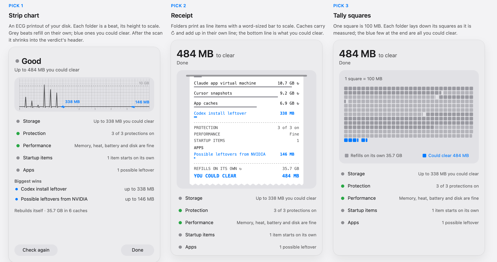
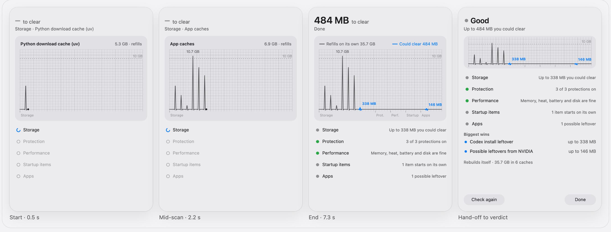
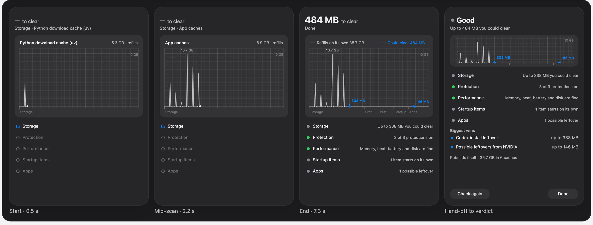

# What should Smart Check look like while it runs?

Research for Vitals' Smart Check scan graphic, 7 Nov 2026. Research only: no Vitals code or contract was changed. **Audited and fixed the same day: see [vitals-scan-graphics-audit.md](vitals-scan-graphics-audit.md). The sketches no longer use blue, and each one ends on the real results screen. An independent re-check then ranked them tally squares, receipt, strip chart; that ranking and its scores replace the ones below, and the descriptions below are of the first version.**

**Animated sketches** (all three, real data, light and dark, with a Reduce Motion switch): https://claude.ai/artifact/TBPNJuE1iJjHyKZTDUxNSw. The source is [vitals-scan-graphics/sketches.html](vitals-scan-graphics/sketches.html), with still frames beside it.

All sketches use Evan's real scan from `audits/2026-11-vitals/2026-11-07/smart-check.json`, in the order the app measured it: uv, npm, pnpm, Claude VM, Cursor, App caches, Codex leftover (Storage), then NVIDIA (Apps). They use the app's own pacing: 0.35 s per folder and 0.9 s per stage, about 7.3 s in total. Six caches refill on their own (35.7 GB). Two folders could be cleared (484 MB, 1.35%).

## Short answer

1. **Strip chart** (an ECG printout of your disk). This is the top pick.
2. **Receipt**.
3. **Tally squares** (one square = 100 MB).

All three draw sizes to scale, so the wins look small, as they really are. They keep caches and wins apart with one rule (grey refills, blue could clear) and end on the same numbers as the verdict. The strip chart ranks first because it is the only one that also belongs to Vitals' own world: the audit's direction is "a bedside vitals monitor: one trace, a few figures". It also shrinks neatly into the verdict screen. Its risk is "makes no sense", which is why it needs labels: the live readout and the two blue size labels. Without them it becomes the unlabelled heartbeat that would go the way of the globe.

## Shortlist

### 1. Strip chart: score 33 of 35

ECG machines print the trace onto gridded paper, and this does the same for your disk. A pen moves left to right across faint graph paper for the length of the scan. Each folder it measures makes one beat, and the beat's height is the folder's size on one fixed scale, with a dashed "10 GB" line so the scale is readable. Caches draw in grey. A folder you could clear draws in blue with its size beside it, and because it is honest, the blue beats are tiny (338 MB is about 3% of the 10.7 GB beat). A readout above the trace names the latest folder, like a monitor's figure box ("npm cache · 2.8 GB · refills"). Stages show as ticks along the bottom. The stages with nothing to report draw a flat line, which is true: nothing found. When the scan ends, the readout becomes a key ("Refills on its own 35.7 GB · Could clear 484 MB"). The strip then shrinks to a 96 pt band at the top of the verdict, so the picture you watched becomes the verdict's header and nothing jumps.

| Test | Score | Why |
|---|---|---|
| Makes sense | 4 | Readout and blue labels make it legible; unlabelled it would read as "heart rate". |
| True | 5 | Linear heights, fixed unit, wins shown small, no minimum size. |
| Native | 4 | System fonts and colours, one accent; graph paper is the only flourish. |
| Buildable | 5 | One `Canvas` path in a `TimelineView`. |
| Snapshot-safe | 5 | Pure shapes and text; a frame is a function of elapsed time. |
| Motion | 5 | The sweep is the pacing; Reduce Motion draws the finished strip at once. |
| Delight | 5 | Fits the app's name, and the tiny blue beat makes the point by itself. |

### 2. Receipt: score 32 of 35

Smart Check prints a receipt. Each folder comes out as a line item with its size, and under it a hairline bar to scale (Tufte's word-sized graphic). Caches carry ↻. Wins print in blue. Each stage prints its own short line ("PROTECTION 3 of 3 on"). The paper feeds up as it grows. At the end it prints two totals, "REFILLS ON ITS OWN ↻ 35.7 GB" and, in bold blue, "YOU COULD CLEAR 484 MB", and tears off. It makes the most sense of any idea here: everyone knows how to read a receipt, and the total is the answer. It loses a point on native, because a paper receipt in a Liquid Glass panel is mild skeuomorphism (a design that imitates a physical object), and a point on delight, because it is the least surprising. The scroll also hides the first items by the end, though the verdict lists the wins anyway.

| Makes sense | True | Native | Buildable | Snapshot | Motion | Delight |
|---|---|---|---|---|---|---|
| 5 | 5 | 3 | 5 | 5 | 5 | 4 |

### 3. Tally squares: score 32 of 35

This is Otto Neurath's Isotype rule: one symbol is a fixed amount, and more means more symbols, not bigger ones. One square is 100 MB. Each folder lays down its own run of squares as it is measured, with alternating greys so you can see where one folder ends and the next begins, and a partial square for the remainder. The 35.7 GB of caches fill about 360 grey squares. Then the two wins add a few blue ones at the very end. That is the most honest picture of "1.3%" in this list, and you can count it. It is also the only idea that never needs a rescale (see below), because its unit is fixed before anything is found. It is the calm, buildable version of the sand jar, but it gives up the jar's physics, so its delight is lower.

| Makes sense | True | Native | Buildable | Snapshot | Motion | Delight |
|---|---|---|---|---|---|---|
| 4 | 5 | 5 | 5 | 5 | 5 | 3 |

## Every concept considered

Scores run from 1 to 5. **Total** is out of 35. ★ marks the shortlist.

| Concept | What it shows | Sense | True | Native | Build | Snap | Motion | Delight | Total | Main risk |
|---|---|---|---|---|---|---|---|---|---|---|
| ★ Strip chart *(new)* | ECG printout: a labelled beat per folder, height to scale | 4 | 5 | 4 | 5 | 5 | 5 | 5 | **33** | Reads as heart rate if the labels are cut |
| ★ Receipt *(Nov 7)* | Line items, ↻ caches, total you could clear | 5 | 5 | 3 | 5 | 5 | 5 | 4 | **32** | Skeuomorphic; the least surprising |
| ★ Tally squares *(new)* | Isotype grid, 1 square = 100 MB | 4 | 5 | 5 | 5 | 5 | 5 | 3 | **32** | Calm to the point of plain |
| Live ledger *(new)* | Stage rows growing one line per folder with a word-sized bar | 5 | 5 | 5 | 5 | 5 | 5 | 2 | 32 | Fails the brief: not creative, close to what's there now |
| Vitals monitor *(Nov 7)* | Unlabelled ECG sweep, beat height by size | 2 | 4 | 4 | 5 | 5 | 5 | 4 | 29 | **High "makes no sense" risk**: a beat with no name is decoration (the globe's problem) |
| Weigh-in scale *(new)* | Folders drop onto a kitchen scale, which reads the running weight | 4 | 3 | 3 | 5 | 5 | 4 | 4 | 28 | One readout mixes caches with wins; two pans get fussy |
| Tape measure *(new)* | A ruler unrolls; each folder takes up its length | 3 | 5 | 4 | 5 | 5 | 4 | 2 | 28 | It is the disk bar Evan already said no to |
| Odometer *(new)* | Two rolling counters: "refills" and "could clear" | 5 | 3 | 2 | 5 | 5 | 4 | 3 | 27 | No sense of scale (484 MB and 35.7 GB are both just digits); the contract says "no number animation" |
| Packing crates *(new)* | A treemap built live: boxes sized by folder, wins in blue | 3 | 5 | 4 | 3 | 5 | 3 | 3 | 26 | Layout reflows as boxes arrive; reads like DaisyDisk or a storage bar |
| Split-flap board *(Nov 7)* | Rows flip to each folder and size, then the total | 4 | 4 | 2 | 4 | 4 | 3 | 4 | 25 | The flip *is* the idea, but snapshots freeze it and Reduce Motion removes it; no scale |
| Sand jar *(Nov 7)* | ~100 MB per grain; grey caches, a thin blue layer | 3 | 4 | 3 | 3 | 4 | 3 | 5 | 25 | Physics makes each run different; grains need a key; heavy to run |
| SceneKit ring *(rejected Nov 6)* | 3D ring | 1 | 2 | 2 | 1 | 1 | 2 | 1 | 10 | "Unfinished renderings"; SceneKit is soft-deprecated |
| Data globe *(rejected, vitals#15)* | Dot sphere with wedges | 1 | 1 | 2 | 3 | 3 | 3 | 2 | 15 | 5% minimum width made 1.3% look big; "makes no sense" |
| Disk bar *(rejected Nov 7)* | macOS Storage-style stacked bar | 5 | 5 | 5 | 5 | 5 | 4 | 1 | 30 | "I want something more creative" |

What's left out, as the brief asks: orbs, particles, spinners and radar sweeps. They only mean "busy".

## Top pick, frame by frame

- **Start (0 to 0.35 s).** Empty graph paper, a flat line and a pen dot at the left. The readout says "Measuring…". The header shows "– to clear" over "Storage". The Storage row shows the active ring and the other four are hollow.
- **Mid-scan (about 2.2 s).** Six grey beats sit close together (17 pt apart at panel width). The 10.7 GB beat has its size printed over it. The readout names the newest folder ("App caches · 6.9 GB · refills"). The header line says "Storage · App caches". At 2.45 s the Codex beat lands in blue with "338 MB" beside it, and the header figure changes from "–" to "338 MB".
- **Quiet stages (3.35 to 6 s).** The pen draws a flat line through Protection, Performance and Startup items, and their rows settle one by one with their real summaries. The flat line is honest: those stages find health, not folders.
- **End (7.3 s).** The NVIDIA beat lands at 6.4 s in blue ("146 MB"), the pen dot disappears, and the readout becomes the key: "Refills on its own 35.7 GB · Could clear 484 MB". The header says "484 MB to clear" over "Done".
- **Hand-off to the verdict (7.6 to 8.2 s).** The strip springs from 250 pt to a 96 pt band, keeping its beats and blue labels. The header cross-fades to the verdict word ("Good"). Under the five stage rows, "Biggest wins" fades in, and each win's blue dot matches a blue beat above it. The "Rebuilds itself" line and Check again / Done follow. The layout matches the current verdict with the band added, so the screen doesn't move.
- **Reduce Motion.** No pacing, as the app already does. After the real ~1.5 s scan, the finished strip and verdict appear at once with a plain cross-fade: no sweep and no spring.
- **Snapshots.** `--tab check-running` freezes the strip at a fixed elapsed time (2.2 s is a good frame), and `--tab check` draws the hand-off frame. Both are plain `Canvas` drawing, so `ImageRenderer` handles them.

### Notes for whoever builds it

- **Fix the scale before the first beat.** If the runner already holds the Storage results when the paced reveal starts (the real scan takes about 1.5 s), set the height scale to the largest folder. If it doesn't, rescale the beats smoothly when a bigger one lands. That stays honest, but it moves. The same goes for the receipt's bars. The tally never has this problem.
- Put the x position on elapsed time (or on reveal slot, to give quiet stages less room). Use linear heights with no minimum. Draw a size label on every win and on the largest beat only, because labels on every beat collide at 17 pt apart.
- The wording follows the app's own: "refills", "could clear", "up to X" in the verdict. Colour only means the two kinds: grey for refills, the accent for could clear.

## Precedents

- **Patient monitors and ECG strip printouts.** One trace is swept in real time, with a parameter box of figures beside it, so a single glance gives both shape and number. The erase-bar versus scrolling debate is in [US patent 5953018](https://patents.google.com/patent/US5953018). Sweep speed is a user setting on real monitors ([GE B30 manual](https://manualslib.com/manual/2951126/Ge-Healthcare-B30.html?page=102)). This is why the strip chart keeps a readout and doesn't use a scrolling trace: the newest beat is always at the pen.
- **Isotype (Otto Neurath and Gerd Arntz).** Repeat a symbol of fixed value; never enlarge it, because people misjudge areas but can count ([Gerd Arntz archive](https://gerdarntz.org/content/gerd-arntz.html), [Isotype overview](https://en.wikipedia.com/wiki/Vienna_Method)). Fixed units round off awkward values ([Visible Language](https://journals.uc.edu/index.php/vl/article/download/5935/4799/7612)), so the tally draws a partial square instead.
- **Waffle and unit charts.** Readers *feel* "4 out of 360" better than they read "1.3%" ([Storytelling with Data](https://www.storytellingwithdata.com/blog/what-is-a-square-area-chart), [visualizing.org](https://www.visualizing.org/waffle-chart)).
- **Tufte's sparklines.** Small, word-sized graphics set inside text and numbers ([Tufte](https://www.edwardtufte.com/?p=299)). This is the receipt's hairline bar.
- **Receiptify.** It turns listening data into a receipt that people instantly understand and share ([Scotsman](https://www.scotsman.com/lifestyle/tech/spotify-receiptify-how-to-create-a-spotify-receipt-based-on-your-favourite-songs-3749546), [Bustle](https://www.bustle.com/life/spotify-receipt-receiptify-how-to-make)). It shows the receipt is a known format for "here's your data, itemised".
- **Vestaboard and split-flap boards.** The mechanics are the delight, and the design puts the characters first ([Vestaboard](https://www.vestaboard.com/split-flap-display), [Bould Design](https://bould-design.squarespace.com/new-notable/2020/7/15/vestaboard-ships)). The charm lives in the flip, which is exactly what a snapshot and Reduce Motion remove.
- **DaisyDisk.** It drew its sunburst live during the scan, then gave up and used a separate progress animation followed by the finished map ([DaisyDisk blog](https://daisydiskapp.com/blog/the-birth-of-daisydisk/)). That supports one idea that ends on the result, and argues against abstract scan art.
- **GrandPerspective.** A treemap of the disk ([FossHub](https://fosshub.com/GrandPerspective.html)). Area is honest, but the layout is arbitrary, which is the crates' risk.
- **CleanMyMac.** Its scan uses heavy 3D animation that TidBITS called distracting, and it has its own setting to reduce motion ([TidBITS](https://tidbits.com/watchlist/cleanmymac-5-0/), [9to5Mac](https://9to5mac.com/2024/10/16/macpaw-releases-major-update-to-cleanmymac-with-fresh-design-and-new-features)). This is what Vitals is trying not to be.
- **Playdate (Panic).** Small, high-frame-rate system animations that each carry meaning: eyes that open on unlock, a page-turn while the Catalog loads ([Clip Content](https://clipcontent.substack.com/p/the-playful-design-details-of-the?open=false), [Designing for Playdate](https://sdk.play.date/designing-for-playdate)). The delight comes from one small idea done precisely.
- **Nothing Glyph Matrix.** Progress shown as simple pixel fills on a dot grid, with "a clear sense of progression" instead of exact numbers ([Nothing Community](https://nothing.community/d/51062-glyph-matrix-everything-about-it), [9to5Google](https://9to5google.com/2025/07/01/heres-what-you-can-do-with-nothing-phone-3-new-glyph-matrix/)). This is the tally's look, but Vitals keeps the exact numbers beside it.
- **Teenage Engineering.** The OP-1's tape reel and the EP-133's "super segment" display treat a tiny screen as an instrument face, mixing segment readouts with icons ([Engadget](https://www.engadget.com/teenage-engineerings-ko-ii-sampler-review-150038528.html), [CDM](https://cdm.link/2010/01/17/teenage-engineerings-op-1-instrument-hands-on-videos-why-its-different/)). This is the reason to pick one instrument and commit to it.
- **SceneKit status.** Soft-deprecated at WWDC25: it gets critical fixes only, and Apple advises against it for new work ([WWDC25 session 288](https://developer.apple.com/videos/play/wwdc2025/288)).
- **ImageRenderer limits.** It draws SwiftUI-native content only; native views such as scroll views, pickers and media players come out as placeholders ([Apple forums](https://developer.apple.com/forums/thread/725196), [Picker thread](https://developer.apple.com/forums/thread/725130)). Every concept on the shortlist is plain `Canvas` drawing.

## Sound and haptics (noted, not pushed)

- **Trackpad haptics don't fit.** Apple's macOS haptics (`NSHapticFeedbackManager`: alignment, level change, generic) are meant for drags and force clicks the user is doing ([HIG: Playing haptics](https://developer.apple.com/design/human-interface-guidelines/playing-haptics), [Apple docs](https://developer.apple.com/tutorials/data/documentation/appkit/nshapticfeedbackmanager/feedbackpattern.md)). The trackpad only plays them while a finger is on it, and during a scan Evan is just watching. A haptic per item would mostly never be felt, and it goes against Apple's guidance.
- **Sound has a precedent.** The Geiger counter is the classic example of a click per event: the rate tells you the amount without looking ([Sonification](https://en.wikipedia.org/wiki/Sonification), [Manchester 2023](https://research.manchester.ac.uk/en/publications/sonification-of-ionising-radiation-data-for-robot-operators/)). The research also says sound is good for drawing attention to events and poor for absolute readings. On a Mac, the familiar cases are one-off sounds: emptying the Trash, a screenshot. If anything, one quiet "done" sound at the end that respects the system's "Play user interface sound effects" setting would fit. A click per folder would fit the strip chart's monitor world, but in a menu-bar app it is more likely to annoy than to delight. My recommendation is no sound by default.

## Open questions for Evan

- Which of the three do you like when you watch them play? The link is at the top.
- If it's the strip chart: should it stay on the verdict as a small band (as sketched), or disappear when the scan ends?
